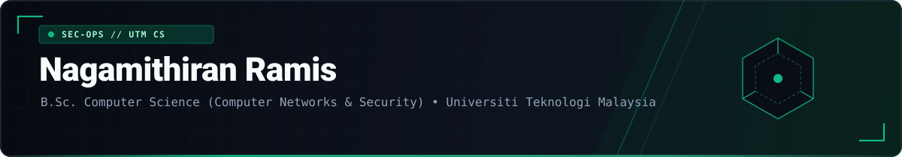
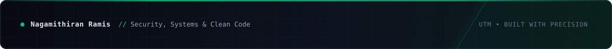

  

 

<!-- Animated Typing Headline -->

  

<!-- Monochrome + Emerald Accent Badges -->

  

<!-- Interactive Quick Navigation Bar -->

  <a href="#-about-me"><b>About</b></a> •
  <a href="#-technical-skills"><b>Skills</b></a> •
  <a href="#-featured-projects"><b>Featured Projects</b></a> •
  <a href="#-research-interests"><b>Research</b></a> •
  <a href="#-github-statistics"><b>Activity & Stats</b></a> •
  <a href="#-contact-information"><b>Connect</b></a>

 

<!-- Animated Typing Headline -->

  

<!-- Identity & Focus Badges -->

  

<!-- Interactive Quick Navigation Bar -->

  <a href="#-about-me"><b>About</b></a> •
  <a href="#-technical-skills"><b>Skills</b></a> •
  <a href="#-featured-projects"><b>Featured Projects</b></a> •
  <a href="#-research-interests"><b>Research</b></a> •
  <a href="#-github-statistics"><b>Activity & Stats</b></a> •
  <a href="#-contact-information"><b>Connect</b></a>

---

## 👨‍💻 About Me

I am a **Bachelor of Computer Science (Computer Networks and Security)** undergraduate at **Universiti Teknologi Malaysia (UTM)**, focused on writing structured, reliable code and building practical security & privacy tools.

- 🎓 **Degree:** B.Sc. Computer Science (Computer Networks & Security) — **UTM**
- 🧠 **Approach:** Clear logic, edge-case testing, and readable, modular implementation
- 🎯 **Direction:** Network defense, applied cryptography fundamentals, and secure software engineering

> *"Strong security starts with clear fundamentals, clean logic, and careful attention to edge cases."*

<b>✨ Expandable Snapshot: How I Build & Learn</b>

 

- **Algorithmic & Systems Practice:** Implementing structured logic, loop/input validation, and modular components in C++, Java, and Python.
- **Security-First Mindsets:** Exploring entropy evaluation, text obfuscation, and client-side privacy trade-offs through hands-on builds.
- **Continuous Iteration:** Shipping working tools to GitHub, documenting architecture clearly, and refining UI/UX across releases.

---

## 🛠 Technical Skills

### Languages & Web Foundations

  

 

  
  
  
  
  
  

### Tooling, OS & Core CS Pillars

  

 

| Category | Core Competencies |
| :--- | :--- |
| **Systems & Programming** | C++, Java, Python, Data Structures, Object-Oriented Programming (OOP) |
| **Security & Theory** | Computer Networks & Security, Discrete Mathematics, Digital Logic Design |
| **Developer Environment** | Linux / Ubuntu, Git & GitHub, VS Code, Static Web Deployment |

---

## 🚀 Featured Projects

### 1. 🔐 CipherChat — Client-Side Private Message Encoder
<table>
  <tr>
    <td width="62%" valign="top">
      

        A zero-dependency browser web app that encodes and decodes messages locally using a configurable <b>Caesar Cipher (shifts 1–25)</b> paired with an optional <b>Unicode-safe Base64 stealth layer</b> for emojis, spaces, and special characters.
      

      

        
        
        
        
      

      

        <a href="https://nagamithiran02.github.io/cipher-chat/"><b>🌐 Live Demo →</b></a> &nbsp;|&nbsp;
        <a href="https://github.com/nagamithiran02/cipher-chat"><b>📂 Source Code →</b></a>
      

    </td>
    <td width="38%" valign="middle" align="center">
      <b>100% Browser-Based</b> 
      No server storage • UTF-8 safe • 1-click copy
    </td>
  </tr>
</table>

### 2. 🛡️ Password Entropy Analyzer
<table>
  <tr>
    <td width="58%" valign="top">
      

        A modular <b>Python</b> tool for evaluating password unpredictability via Shannon entropy, detecting common/weak patterns, and generating stronger credentials.
      

      

        
        
      

      

        <a href="https://github.com/nagamithiran02/password-entropy-analyzer"><b>📂 Explore Repository →</b></a>
      

    </td>
    <td width="42%" valign="middle" align="center">
      
    </td>
  </tr>
</table>

---

## 🔬 Research Interests

| Focus Area | What I'm Exploring |
| :--- | :--- |
| **Authentication & Credential Hygiene** | Password entropy modeling, pattern heuristics, and practical breach-awareness checks |
| **Network & Protocol Security** | Core networking mechanics, secure transport principles, and defensive foundations |
| **Resilient Software Engineering** | Input validation, predictable state handling, and clean separation of logic |

---

## 📊 GitHub Statistics

  

---

## 📬 Contact Information

 

  

